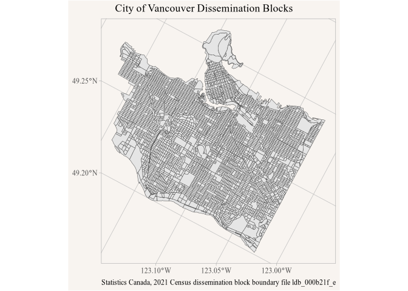
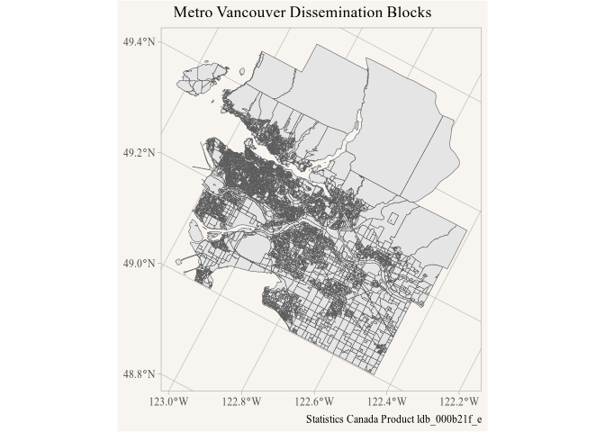
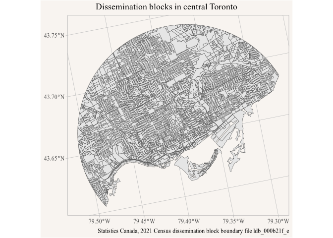

<!-- Generated from vignettes.orig/accessing_public_buckets.Rmd -- do not edit. -->
<!-- Rebuild with: Rscript vignettes.orig/precompute.R -->


``` r
library(r2parquet)
library(dplyr)
library(ggplot2)

options(r2parquet.language = "en")
```


As an example we consider accessing dissemination block (DB) level geographic data from the 2021 Canadian census. For this we have prepared a parquet file in a public bucket, it can be reached by url.


``` r
census_db_url <- "https://data.mountainmath.ca/census/2021/ldb_000b21f_e.parquet"
```

The data can be downloaded in full, but often we are interested in a specific part of Canada only, maybe a particular metro area (CMA) or census subdivision (CSD). The first step is to get a lazy connection to the parquet file.


``` r
db_table <- parquet_tbl(census_db_url)

db_table |> colnames()
#>  [1] "DBUID"    "DAUID"    "CTUID"    "CSDUID"   "CMAUID"   "CMAPUID" 
#>  [7] "CDUID"    "PRUID"    "DGUID"    "DBRPLAMX" "DBRPLAMY" "LANDAREA"
#> [13] "geometry"
```

This only reads the parquet metadata, the file carries several geographic identifiers as well as the geography. The table also carries custom metadata that gives more information about data provenance and licence, the primary key, and which geometries were repaired when the file was written.


``` r
db_table |> parquet_metadata()
#> <parquet metadata: 18 entries>
#>                   en                              fr
#> licence           Statistics Canada Open Licence  Licence ouverte de Statistiqu…
#> licence_url       https://www.statcan.gc.ca/en/…  https://www.statcan.gc.ca/fr/…
#> title             2021 Census – Boundary files …  Recensement de 2021 – Fichier…
#> source_url        https://www12.statcan.gc.ca/c…  https://www12.statcan.gc.ca/c…
#> reference_guide   https://www12.statcan.gc.ca/c…  https://www12.statcan.gc.ca/c…
#> attribution       Statistics Canada, 2021 Censu…  Statistique Canada, Fichier d…
#> notes             The identifiers of the contai…  Les identificateurs des géogr…
#> columns           <13 columns, see below>
#> primary_key       DBUID
#> geometry_repairs  {"columns":"DBUID","rows":["10010273010","10010667008","10010…
#> processing        Repaired 830 of 498,547 geometries that were invalid, via sf:…
#> 
#> columns     en                                 fr
#>   DBUID     Dissemination block ID             Identificateur unique de l'îlot …
#>   DAUID     Dissemination area ID              Identificateur unique de l'aire …
#>   CTUID     Census tract ID                    Identificateur unique du secteur…
#>   CSDUID    Census subdivision ID              Identificateur unique de la subd…
#>   CMAUID    Census metropolitan area or cens…  Identificateur unique de la régi…
#>   CMAPUID   CMA/CA provincial part ID: Provi…  Identificateur unique de la part…
#>   CDUID     Census division ID                 Identificateur unique de la divi…
#>   PRUID     Province or territory ID           Identificateur unique de la prov…
#>   DGUID     Dissemination geography unique i…  Identificateur unique de géograp…
#>   DBRPLAMX  Representative point, x (Lambert)  Point représentatif, x (Lambert)
#>   DBRPLAMY  Representative point, y (Lambert)  Point représentatif, y (Lambert)
#>   LANDAREA  Land area (km²)                    Superficie des terres (km²)
#>   geometry  Boundary, Statistics Canada Lamb…  Limites, projection conique conf…
```

Metadata information can be multi-lingual. Setting the `r2parquet.language` option as at the top of this vignette picks the language that will be used for labelling.

A simple query would be to fetch the data for just the City of Vancouver. The query keeps every column, and the first time that happens with a remote table `collect_parquet()` says so: parquet is stored by column and only the selected columns get downloaded, so the message gives a `select()` of all the columns to paste into the query and prune to the ones needed.


``` r
data_csd <- db_table |>
  filter(CSDUID=="5915022") |>
  collect_parquet()
#> Collecting all 13 columns of https://data.mountainmath.ca/census/2021/ldb_000b21f_e.parquet. Parquet is stored by column and only the selected columns get downloaded, so select the ones you need: add
#>   select(DBUID, DAUID, CTUID, CSDUID, CMAUID, CMAPUID, CDUID, PRUID, DGUID, DBRPLAMX, DBRPLAMY, LANDAREA, geometry)
#> to the query and remove the columns you don't need. This message is shown once per session.

ggplot(data_csd) +
  geom_sf() +
  labs(title="City of Vancouver Dissemination Blocks",
       caption=parquet_sources_attribution(data_csd, sep="\n"))
```

<div class="figure">

<p class="caption">Example of using a remote geoparquet file</p>
</div>

Similarly, we can fetch the data for Metro Vancouver. The remote parquet file is over 300 MB in size, but both these queries run in less than a second because under the hood only the ranges for the data that's actually required are identified and read, with only limited unneeded data making the trip from R2 to the R session.


``` r
data_cma <- db_table |>
  filter(CMAUID=="933") |>
  collect_parquet()

ggplot(data_cma) +
  geom_sf() +
  labs(title="Metro Vancouver Dissemination Blocks",
       caption=parquet_sources_attribution(data_cma, sep="\n"))
```

<div class="figure">

<p class="caption">Example of a larger data pull.</p>
</div>

To build on this we query the geographic attributes hosted at


``` r
geo_attributes_path <- "https://data.mountainmath.ca/census/2021/2021_92-151_X.parquet"
```

and join just the population counts onto the Metro Vancouver dissemination blocks. Joining the lazy tables before collecting runs as one DuckDB query, and `collect_parquet()` records the metadata of every table the result was read from, not just of the left-hand one that `parquet_metadata()` returns.


``` r
data_cma <- db_table |>
  filter(CMAUID=="933") |>
  left_join(parquet_tbl(geo_attributes_path) |>
              select(DBUID,Population=DBPOP2021),
            by="DBUID") |>
  collect_parquet()

parquet_sources(data_cma) |>
  transmute(file=basename(path),attribution)
#> # A tibble: 2 × 2
#>   file                  attribution                                             
#>   <chr>                 <chr>                                                   
#> 1 ldb_000b21f_e.parquet Statistics Canada, 2021 Census dissemination block boun…
#> 2 2021_92-151_X.parquet Statistics Canada, 2021 Census Geographic Attribute Fil…
```

`parquet_sources_attribution()` turns these into one string for the caption, separated by `sep`, one per line here so the caption fits the figure; attributions that only differ in their last word, two products of one series say, get combined into one.


``` r
data_cma |>
  mutate(density=Population/(LANDAREA*100)) |>
  mutate(density=if_else(is.finite(density),density,0)) |>
  mutate(bands=cut(density,breaks=c(-Inf,0,10,20,50,100,200,500,1000,Inf),
                   labels=c("0","0-10","10-20","20-50","50-100","100-200",
                            "200-500","500-1000",">1000"))) |>
  ggplot(aes(fill=bands)) +
  geom_sf(colour=NA) +
  scale_fill_viridis_d(option = "magma") +
  labs(title="Population density in Metro Vancouver",
       fill="Pop/ha",
       caption=parquet_sources_attribution(data_cma, sep="\n"))
```

<div class="figure">

<p class="caption">Example of map using data from joined tables.</p>
</div>


# Spatial queries

We can also use efficient spatial filtering when getting the data, for example querying data within a 10 km radius around central Toronto.


``` r
library(sf)
#> Linking to GEOS 3.13.0, GDAL 3.8.5, PROJ 9.5.1; sf_use_s2() is TRUE

mask <- st_point(c(-79.3842, 43.6514)) |> 
  st_sfc(crs = 4326) |>
  st_buffer(10000, max_cells = 10000) 

data_mask <- db_table |>
  st_filter(mask) |>
  collect_parquet()

data_mask |>
  st_set_agr("constant") |>
  st_intersection(mask |> st_transform(st_crs(data_mask))) |>
  ggplot() +
  geom_sf() +
  labs(title="Dissemination blocks in central Toronto",
       caption=parquet_sources_attribution(data_mask, sep="\n")) 
```

<div class="figure">

<p class="caption">Example of a spatial query</p>
</div>

`st_filter()` on the lazy table returns every feature that intersects the mask, reading only the row groups whose bounding box intersects it. Clipping the returned data with `st_intersection` makes for a prettier plot. Unlike on sf objects, `st_filter()` on lazy tables transforms the mask to the crs of the data automatically, `st_intersection()` needs the explicit transformation.
