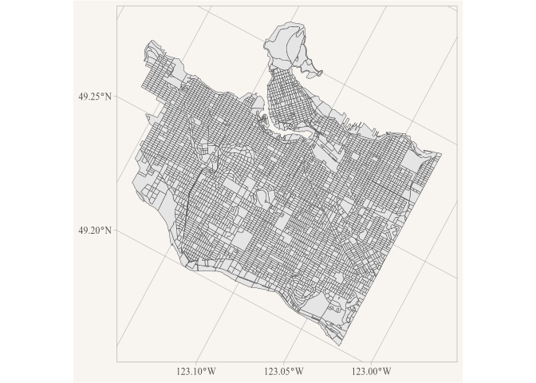
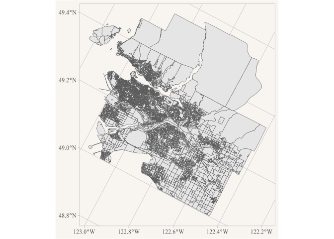
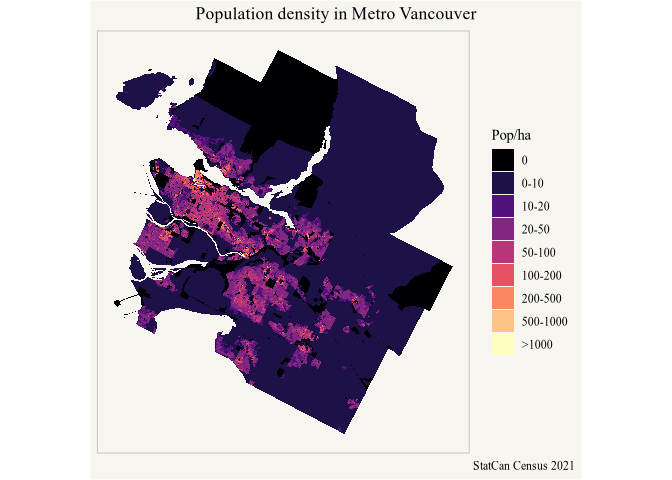
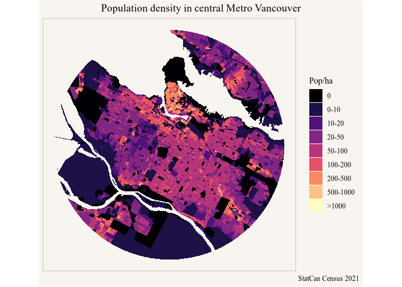

<!-- Generated from vignettes.orig/accessing_public_buckets.Rmd -- do not edit. -->
<!-- Rebuild with: Rscript vignettes.orig/precompute.R -->


``` r
library(r2parquet)
library(dplyr)
library(ggplot2)
```

As an example we consider accessing dissemination block (DB) level geographic data from the 2021 Canadian census. For this we have prepared a parquet file in a public bucket, it can be reached by url.


``` r
census_db_url <- "https://data.mountainmath.xyz/census/2021/ldb_000b21f_e.parquet"
```

The data can be downloaded in full, but often we are interested in a specific part of Canada only, maybe a particular metro area (CMA) or census subdivision (CSD). The first step is to get a lazy connection to the parquet file.


``` r
db_table <- parquet_tbl(census_db_url)

db_table |> colnames()
#>  [1] "DBUID"    "DAUID"    "CTUID"    "CSDUID"   "CMAUID"   "CMAPUID" 
#>  [7] "CDUID"    "PRUID"    "DGUID"    "DBRPLAMX" "DBRPLAMY" "LANDAREA"
#> [13] "geometry"
```

This only reads the metadata, the file carries several geographic identifiers as well as the geography. A simple query would be to fetch the data for just the City of Vancouver.


``` r
data_csd <- db_table |>
  filter(CSDUID=="5915022") |>
  collect_sf()

ggplot(data_csd) +
  geom_sf()
```

<div class="figure">

<p class="caption">plot of chunk vancouver-csd</p>
</div>

Similarly, we can fetch the data for Metro Vancouver. Both these queries run in less than a second because under the hood only the ranges for the data that's actually required are identified and read, with only limited unneeded data making the trip from R2 to the R session.


``` r
data_cma <- db_table |>
  filter(CMAUID=="933") |>
  collect_sf()

ggplot(data_cma) +
  geom_sf()
```

<div class="figure">

<p class="caption">plot of chunk vancouver-cma</p>
</div>

To build on this we query the geographic attributes hosted at


``` r
geo_attributes_path <- "https://data.mountainmath.xyz/census/2021/2021_92-151_X.parquet"
```

and read just the ones for Metro Vancouver.


``` r
geo_attributes <- parquet_tbl(geo_attributes_path) |>
  filter(CMAUID=="933") |>
  select(DBUID,Population=DBPOP2021) |>
  collect()
```


``` r
data_cma |>
  left_join(geo_attributes, by="DBUID") |>
  mutate(density=Population/(LANDAREA*100)) |>
  mutate(density=if_else(is.finite(density),density,0)) |>
  mutate(bands=cut(density,breaks=c(-Inf,0,10,20,50,100,200,500,1000,Inf),
                   labels=c("0","0-10","10-20","20-50","50-100","100-200",
                            "200-500","500-1000",">1000"))) |>
  ggplot(aes(fill=bands)) +
  geom_sf(colour=NA) +
  scale_fill_viridis_d(option = "magma") +
  labs(title="Population density in Metro Vancouver",
       fill="Pop/ha",
       caption="StatCan Census 2021") +
  coord_sf(datum=NA)
```

<div class="figure">

<p class="caption">plot of chunk vancouver-density</p>
</div>


# Spatial queries

We can also use efficient spatial filtering when getting the data, for example querying data within a 10 km radius around the centroid of the City of Vancouver.


``` r
library(sf)
#> Warning: package 'sf' was built under R version 4.6.1
#> Linking to GEOS 3.13.0, GDAL 3.8.5, PROJ 9.5.1; sf_use_s2() is TRUE

mask <- st_point(c(-123.108, 49.249)) |> 
  st_sfc(crs = 4326) |>
  st_buffer(10000, max_cells = 10000) 

data_mask <- db_table |>
  filter_spatial(mask) |>
  collect_sf()

data_mask |>
  st_set_agr("constant") |>
  st_intersection(mask |> st_transform(st_crs(data_mask))) |>
  ggplot() +
  geom_sf()
```

<div class="figure">

<p class="caption">plot of chunk radius</p>
</div>

The `filter_spatial` function returns every feather that intersects the mask, clipping the returned data with `st_intersection` makes for a prettier plot.
