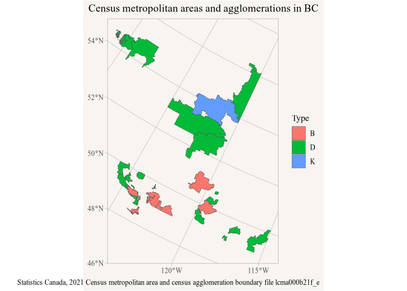

<!-- Generated from vignettes.orig/s3.Rmd -- do not edit. -->
<!-- Rebuild with: Rscript vignettes.orig/precompute.R -->


``` r
library(r2parquet)
library(dplyr)
library(ggplot2)

options(r2parquet.language = "en")
```

`r2parquet` is designed around Cloudflare R2, but it can also interact with the S3 API. Buckets on Amazon S3, and on other services with an S3 compatible API like MinIO, are addressed as `s3://bucket/path` and work with the same functions as `r2://bucket/path`: `data_to_parquet()` and `upload_parquet()` write, `parquet_tbl()` reads, `list_parquet()` lists, `cache_parquet()` caches, `presigned_url()` shares, `remove_parquet()` removes, and directory uploads get their `_manifest.json` like on R2 (see the [Metadata and manifests](metadata.html) article). This article walks through uploading private and public data to S3.

## Credentials

`s3://` paths use the environment variables that the AWS command line tools and SDKs use, so a machine that is already set up for AWS needs nothing new. Set them in `~/.Renviron` (`usethis::edit_r_environ()` opens it, restart R afterwards):

```sh
AWS_ACCESS_KEY_ID=...
AWS_SECRET_ACCESS_KEY=...
AWS_DEFAULT_REGION=ca-central-1   # or AWS_REGION, the region of the bucket, default us-east-1
```

Temporary credentials come with an `AWS_SESSION_TOKEN` as well. The package does not read AWS profiles in `~/.aws/` itself, but the AWS command line tool prints the variables for the current profile:

```sh
eval "$(aws configure export-credentials --format env)"
```

The credentials need the `s3:GetObject`, `s3:PutObject`, `s3:DeleteObject` and `s3:ListBucket` permissions on the bucket, and `s3:GetBucketPolicy`, `s3:PutBucketPolicy` and `s3:DeleteBucketPolicy` for public access as described below.

### Other S3 compatible services

Services other than Amazon S3 get their endpoint from `AWS_ENDPOINT_URL_S3` or `AWS_ENDPOINT_URL`, again the variables AWS tools use. A local MinIO server, for example:

```sh
AWS_ACCESS_KEY_ID=minioadmin
AWS_SECRET_ACCESS_KEY=minioadmin
AWS_ENDPOINT_URL=http://localhost:9000
```

With a custom endpoint the bucket goes into the path of the requests (`http://localhost:9000/bucket/key`), on Amazon S3 into the host name (`https://bucket.s3.ca-central-1.amazonaws.com/key`); `R2PARQUET_S3_URL_STYLE` set to `path` or `vhost` overrides that for services that want the other style. The package relies on two parts of the S3 API that not every service implements: conditional writes (`If-Match` and `If-None-Match`), which keep concurrent uploads from overwriting each other's manifest updates, and batch deletes. Amazon S3 and MinIO support both.

## Private data

By default all uploads the package makes are private. As an example we take the dissemination block level geographic attributes of Metro Vancouver from the public census bucket and write them to S3. `data_to_parquet()` writes lazy tables without collecting them. The metadata of the source doesn't get carried over by itself, it describes the source rather than the subset, so we pass on the entries that still apply, its attribution and licence; without `metadata` the write would warn that the source has metadata.


``` r
private_path <- paste0(params$s3_root, "/private/van_db_attributes.parquet")

geo_attributes <- parquet_tbl("https://data.mountainmath.ca/census/2021/2021_92-151_X.parquet")

geo_attributes |>
  filter(CMAUID == "933") |>
  select(DBUID, DAUID, CSDUID, CSDNAME, Population = DBPOP2021, Dwellings = DBTDWELL2021) |>
  data_to_parquet(private_path, sort_by = "DBUID",
                  metadata = parquet_metadata(geo_attributes)[c("title_en", "title_fr", "attribution_en", "attribution_fr",
                                                                "licence_en", "licence_fr", "licence_url_en", "licence_url_fr")])
#> Uploading 85.9 kB in 1 parquet file to s3://mountainmath/test/vignette/private/van_db_attributes.parquet.
```

With credentials the file reads like any other.


``` r
parquet_tbl(private_path) |>
  group_by(CSDNAME) |>
  summarize(Population = sum(Population, na.rm = TRUE), .groups = "drop") |>
  arrange(desc(Population)) |>
  head(5) |>
  collect()
#> # A tibble: 5 × 2
#>   CSDNAME   Population
#>   <chr>          <dbl>
#> 1 Vancouver     662248
#> 2 Surrey        568322
#> 3 Burnaby       249125
#> 4 Richmond      209937
#> 5 Langley       161566
```

Without credentials the file is out of reach, see below. To share a private file without sharing credentials, `presigned_url()` signs a URL that grants access to that one file for a limited time, at most a week. Anyone with the URL can read the file until it expires, so treat it like a password; we don't print it here.


``` r
shared_url <- presigned_url(private_path, expires = 3600)
nrow(collect(parquet_tbl(shared_url)))
#> [1] 15406
```

## Public data

On R2 public access is a property of a bucket, granted by connecting a custom domain with `create_r2_bucket()`. On S3 it is granted by the bucket policy, which can make part of a bucket public: `set_s3_public_access()` adds a statement to the policy that lets everyone download the files below a prefix, and leaves the rest of the bucket, and other statements of the policy, as they were. It returns the public URL of the prefix. Amazon S3 takes a while to apply policy changes everywhere, so for a few minutes anonymous requests may still get 403 Forbidden now and then.


``` r
public_prefix <- paste0(params$s3_root, "/public")
public_url <- set_s3_public_access(public_prefix)
#> The files below s3://mountainmath/test/vignette/public are publicly readable at https://mountainmath.s3.ca-central-1.amazonaws.com/test/vignette/public/.
```

Whether a file is public is then decided by where it gets uploaded. Here we copy the census metropolitan area boundaries from the public census bucket, partitioned by province, into the public prefix. The policy only grants downloads, not listing the bucket, so readers find the files of the dataset through the `_manifest.json` that the upload writes next to them.


``` r
cma_source <- parquet_tbl("https://data.mountainmath.ca/census/2021/lcma000b21f_e.parquet")

cma_source |>
  data_to_parquet(paste0(public_prefix, "/cma"), partition_by = "PRUID", sort_by = "CMAUID",
                  metadata = parquet_metadata(cma_source))
#> Uploading 13.1 MB in 12 parquet files to s3://mountainmath/test/vignette/public/cma.
```


Anyone can now read the dataset from its URL, no credentials involved, here the CMAs in British Columbia.


``` r
cma_url <- paste0(public_url, "cma/")
bc_cmas <- parquet_tbl(cma_url) |>
  filter(PRUID == "59") |>
  collect_parquet()
#> Collecting all 9 columns of https://mountainmath.s3.ca-central-1.amazonaws.com/test/vignette/public/cma/. Parquet is stored by column and only the selected columns get downloaded, so select the ones you need: add
#>   select(CMAUID, CMAPUID, DGUID, DGUIDP, CMANAME, CMATYPE, LANDAREA, geometry, PRUID)
#> to the query and remove the columns you don't need. This message is shown once per session.

ggplot(bc_cmas) +
  geom_sf(aes(fill = CMATYPE)) +
  labs(title = "Census metropolitan areas and agglomerations in BC",
       fill = "Type", caption = parquet_sources_attribution(bc_cmas))
```

<div class="figure">

<p class="caption">plot of chunk bc-cmas</p>
</div>

Next to it the private file stays out of reach: requests without credentials get 403 Forbidden for it, while the manifest of the public dataset is served.


``` r
httr::status_code(httr::HEAD(sub("/public/$", "/private/van_db_attributes.parquet", public_url)))
#> [1] 403
httr::status_code(httr::HEAD(paste0(cma_url, "_manifest.json")))
#> [1] 200
```

The manifest carries the metadata of the dataset, so `parquet_metadata()` reads it with a single request, and `list_parquet()` lists the files from it.


``` r
parquet_metadata(cma_url)
#> <parquet metadata: 18 entries>
#>                   en                              fr
#> licence           Statistics Canada Open Licence  Licence ouverte de Statistiqu…
#> licence_url       https://www.statcan.gc.ca/en/…  https://www.statcan.gc.ca/fr/…
#> title             2021 Census – Boundary files …  Recensement de 2021 – Fichier…
#> source_url        https://www12.statcan.gc.ca/c…  https://www12.statcan.gc.ca/c…
#> reference_guide   https://www12.statcan.gc.ca/c…  https://www12.statcan.gc.ca/c…
#> attribution       Statistics Canada, 2021 Censu…  Statistique Canada, Fichier d…
#> notes             One row per provincial part: …  Une ligne par partie provinci…
#> columns           <9 columns, see below>
#> primary_key       CMAPUID
#> geometry_repairs  {"columns":"CMAPUID","rows":["35571","47705"]}
#> processing        Repaired 2 of 156 geometries that were invalid, via sf::st_ma…
#> 
#> columns     en                                 fr
#>   CMAUID    Census metropolitan area or cens…  Identificateur unique de la régi…
#>   CMAPUID   CMA/CA provincial part ID: Provi…  Identificateur unique de la part…
#>   DGUID     Dissemination geography unique i…  Identificateur unique de géograp…
#>   DGUIDP    DGUID of the provincial part, fo…  IDUGD de la partie provinciale, …
#>   CMANAME   CMA/CA name                        Nom de la RMR/AR
#>   CMATYPE   CMA/CA type: B census metropolit…  Genre de RMR/AR: B région métrop…
#>   LANDAREA  Land area (km²)                    Superficie des terres (km²)
#>   PRUID     Province or territory ID           Identificateur unique de la prov…
#>   geometry  Boundary, Statistics Canada Lamb…  Limites, projection conique conf…

list_parquet(cma_url) |>
  mutate(path = sub(cma_url, "", path, fixed = TRUE)) |>
  select(path, size, cache) |>
  head(3)
#> # A tibble: 3 × 3
#>   path                    size     cache     
#>   <chr>                   <chr>    <chr>     
#> 1 PRUID=10/data_0.parquet 171.2 kB not cached
#> 2 PRUID=11/data_0.parquet 131.2 kB not cached
#> 3 PRUID=12/data_0.parquet 848.1 kB not cached
```

Public URLs can be cached like any other, see the [Caching](caching.html) article. Keep public and private data under separate prefixes: a manifest lists every parquet file below its directory, so a public manifest above private files would publish their names and metadata. Manifests of directories above the public prefix, like the one `write_manifest()` writes for a whole bucket, stay private.

Unlike R2, Amazon S3 charges for data downloaded to the internet, and there is no CDN in front of the bucket. For widely used public data that is worth weighing, CloudFront in front of the bucket, or R2, which charges nothing for downloads, are the alternatives.

## Cleaning up

`remove_parquet()` removes files and directories on S3 like on R2, and `set_s3_public_access()` with `public = FALSE` removes the public access again; the bucket policy goes when nothing else is left in it.


``` r
remove_parquet(c(private_path, paste0(public_prefix, "/cma")))
#> Removed 13 files from S3 bucket mountainmath.
set_s3_public_access(public_prefix, public = FALSE)
#> Removed public access to the files below s3://mountainmath/test/vignette/public.
```
