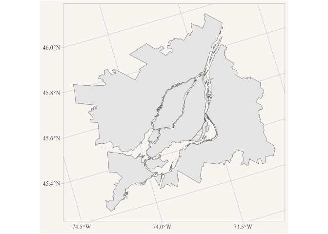

<!-- Generated from vignettes.orig/uploading_data.Rmd -- do not edit. -->
<!-- Rebuild with: Rscript vignettes.orig/precompute.R -->


``` r
library(r2parquet)
library(dplyr)
library(ggplot2)
```

We showcase how to upload tabular and spatial data to R2.

## Tabular data

As an example consider the geographic attributes file for the 2021 census. StatCan has disabled programmatic download, so the file has to be [downloaded manually](https://www12.statcan.gc.ca/census-recensement/alternative_alternatif.cfm?l=eng&dispext=zip&teng=2021_92-151_X.zip&k=%20%20%20%20%209602&loc=/census-recensement/2021/geo/aip-pia/attribute-attribs/files-fichiers/2021_92-151_X.zip) and unzipped into `download_path`, so that `2021_92-151_X.csv` is directly in it.


``` r
path <- file.path(params$download_path, "2021_92-151_X.csv")
```

The file has close to half a million rows, one per dissemination block, and takes 300 MB as CSV. Rather than reading it into R, we let DuckDB read it lazily, `data_to_parquet()` then writes lazy DuckDB tables with a single DuckDB `COPY` straight from the CSV to parquet, and uploads the parquet file, without the data ever being read into an R data frame.

Trial and error determined that the CSV is Windows-1252 encoded, which DuckDB reads via its `encodings` extension. We read all columns as text, otherwise DuckDB would turn codes like `SACCODE` `"001"` into numbers, and convert the numeric columns explicitly instead. The column names are bilingual, like `DBUID_IDIDU`, we keep the English part.


``` r
csv_con <- DBI::dbConnect(duckdb::duckdb())
DBI::dbExecute(csv_con, "INSTALL encodings") |> invisible()

geo_attributes <- tbl(csv_con, sql(paste0(
  "FROM read_csv(", DBI::dbQuoteString(csv_con, path), 
  ", encoding = 'cp1252', all_varchar = true)"))) |>
  rename_with(\(name) sub("_.*", "", name)) |>
  mutate(across(c(DBPOP2021, DBTDWELL2021, DBURDWELL2021), as.integer),
         across(c(DARPLAMX, DARPLAMY, DARPLAT, DARPLONG, DBAREA2021), as.numeric))

geo_attributes
#> # A query:  ?? x 63
#> # Database: DuckDB 1.5.6 [jens@Darwin 27.0.0:R 4.6.1/:memory:]
#>    PRUID PRDGUID     PRNAME PRENAME PRFNAME PREABBR PRFABBR CDUID CDDGUID CDNAME
#>    <chr> <chr>       <chr>  <chr>   <chr>   <chr>   <chr>   <chr> <chr>   <chr> 
#>  1 10    2021A000210 Newfo… Newfou… Terre-… N.L.    T.-N.-… 1001  2021A0… Divis…
#>  2 10    2021A000210 Newfo… Newfou… Terre-… N.L.    T.-N.-… 1001  2021A0… Divis…
#>  3 10    2021A000210 Newfo… Newfou… Terre-… N.L.    T.-N.-… 1001  2021A0… Divis…
#>  4 10    2021A000210 Newfo… Newfou… Terre-… N.L.    T.-N.-… 1001  2021A0… Divis…
#>  5 10    2021A000210 Newfo… Newfou… Terre-… N.L.    T.-N.-… 1001  2021A0… Divis…
#>  6 10    2021A000210 Newfo… Newfou… Terre-… N.L.    T.-N.-… 1001  2021A0… Divis…
#>  7 10    2021A000210 Newfo… Newfou… Terre-… N.L.    T.-N.-… 1001  2021A0… Divis…
#>  8 10    2021A000210 Newfo… Newfou… Terre-… N.L.    T.-N.-… 1001  2021A0… Divis…
#>  9 10    2021A000210 Newfo… Newfou… Terre-… N.L.    T.-N.-… 1001  2021A0… Divis…
#> 10 10    2021A000210 Newfo… Newfou… Terre-… N.L.    T.-N.-… 1001  2021A0… Divis…
#> # ℹ more rows
#> # ℹ 53 more variables: CDTYPE <chr>, FEDUID <chr>, FEDDGUID <chr>,
#> #   FEDNAME <chr>, CSDUID <chr>, CSDDGUID <chr>, CSDNAME <chr>, CSDTYPE <chr>,
#> #   DPLUID <chr>, DPLDGUID <chr>, DPLNAME <chr>, DPLTYPE <chr>, ERUID <chr>,
#> #   ERDGUID <chr>, ERNAME <chr>, CCSUID <chr>, CCSDGUID <chr>, CCSNAME <chr>,
#> #   SACTYPE <chr>, SACCODE <chr>, CMAPUID <chr>, CMAPDGUID <chr>, CMAUID <chr>,
#> #   CMADGUID <chr>, CMANAME <chr>, CMATYPE <chr>, CTUID <chr>, CTDGUID <chr>, …
```

Sorting by the dissemination block id keeps the blocks of each province, census division and subdivision together in the same row groups, so queries filtering on these only download the row groups they need.

We also encode basic metadata on data provenance and licence to give clarity what the data is and where it comes from.


``` r
metadata <- list(
  "title"="2021 Census – Geographic Attribute File",
  "source_url"="https://www12.statcan.gc.ca/census-recensement/2021/geo/aip-pia/attribute-attribs/index2021-eng.cfm?year=2021",
  "reference_guide"="https://www150.statcan.gc.ca/n1/en/catalogue/92-151-G2021001",
  "licence"="Statistics Canada Open Licence",
  "licence_url"="https://www.statcan.gc.ca/en/terms-conditions/open-licence",
  "attribution"="Statistics Canada Product 2021_92-151_X"
)
```


``` r
data_to_parquet(geo_attributes, "r2://test/census/2021/2021_92-151_X.parquet", 
                sort_by = "DBUID", metadata = metadata)
#> Uploading 10.2 MB in 1 parquet file to r2://test/census/2021/2021_92-151_X.parquet.

DBI::dbDisconnect(csv_con, shutdown = TRUE)
```

Reading it back, e.g. the population and dwellings by census subdivision in the Montréal CMA:


``` r
parquet_tbl("r2://test/census/2021/2021_92-151_X.parquet") |>
  filter(CMAUID == "462") |>
  summarise(Population = sum(DBPOP2021, na.rm = TRUE), 
            Dwellings = sum(DBTDWELL2021, na.rm = TRUE),
            .by = CSDNAME) |>
  arrange(desc(Population)) |>
  collect()
#> # A tibble: 93 × 3
#>    CSDNAME                  Population Dwellings
#>    <chr>                         <dbl>     <dbl>
#>  1 Montréal                    1762949    878542
#>  2 Laval                        438366    176115
#>  3 Longueuil                    254483    117006
#>  4 Terrebonne                   119944     46056
#>  5 Saint-Jean-sur-Richelieu      97873     44255
#>  6 Brossard                      91525     37275
#>  7 Repentigny                    86100     34710
#>  8 Saint-Jérôme                  80213     38776
#>  9 Mirabel                       61108     25514
#> 10 Blainville                    59819     22859
#> # ℹ 83 more rows
```

## Spatial data

For this we consider hosting the StatCan metro area (CMA) level geographies from the 2021 census. StatCan has disabled programmatic download, so the geodatabase has to be [downloaded manually](https://www12.statcan.gc.ca/census-recensement/alternative_alternatif.cfm?l=eng&dispext=zip&teng=lcma000b21f_e.zip&k=%20%20%20%20%206393&loc=//www12.statcan.gc.ca/census-recensement/2021/geo/sip-pis/boundary-limites/files-fichiers/lcma000b21f_e.zip) and unzipped so that it ends up at `lcma000b21f_e/lcma000b21f_e.gdb` within `download_path`.

We then read the data and cast it to MULTIPOLYGON. Some StatCan geography files contain MULTISURFACE geometries, which have to be converted before writing parquet files, for this file the cast does not change anything.


``` r
cma_geos <- sf::st_read(file.path(params$download_path,"lcma000b21f_e/lcma000b21f_e.gdb"),
                        quiet = TRUE) |>
  sf::st_cast("MULTIPOLYGON")
```

We then write this to a parquet file on R2, with the first path component being the bucket, which has to exist already (see `create_r2_bucket()` and the [Setting up R2](setting_up_r2.html) article for the credentials needed). 

We again create a basic metadata template.


``` r
metadata <- list(
  "title"="2021 Census – Boundary files - Census metropolitan areas and census agglomerations",
  "source_url"="https://www12.statcan.gc.ca/census-recensement/alternative_alternatif.cfm?l=eng&dispext=zip&teng=lcma000b21g_e.zip&k=%20%20%20%2011472&loc=//www12.statcan.gc.ca/census-recensement/2021/geo/sip-pis/boundary-limites/files-fichiers/lcma000b21g_e.zip",
  "reference_guide"="https://www12.statcan.gc.ca/census-recensement/2021/geo/ref/guide/index2021-eng.cfm?year=21",
  "licence"="Statistics Canada Open Licence",
  "licence_url"="https://www.statcan.gc.ca/en/terms-conditions/open-licence",
  "attribution"="Statistics Canada Product lcma000b21f_e"
)
```

Under the hood `data_to_parquet()` renames the geometry column to `geometry`, repairs invalid geometries, orders the rows by the `sort_by` columns, if any, and further along a Hilbert curve, and uploads the resulting GeoParquet file.


``` r
data_to_parquet(cma_geos, "r2://test/census/2021/lcma000b21f_e.parquet", 
                sort_by = "CMAUID", metadata = metadata )
#> Renaming geometry column SHAPE to the GeoParquet standard name geometry.
#> Repairing 2 invalid geometries via sf::st_make_valid.
#> Uploading 12.9 MB in 1 parquet file to r2://test/census/2021/lcma000b21f_e.parquet.
```

The uploaded file can be queried lazily right away, here we read the Montréal CMA.


``` r
con <- parquet_tbl("r2://test/census/2021/lcma000b21f_e.parquet")

data <- con |>
  filter(CMAUID == "462") |>
  collect_parquet()

ggplot(data) +
  geom_sf() +
  labs(title = "Montréal CMA boundary",
       caption=parquet_metadata(data)$attribution) 
```

<div class="figure">

<p class="caption">plot of chunk montreal</p>
</div>

The metadata is accessible from the lazy table `con` as well as from the collected `data`, and is used here for the caption.

## Other files

Rebuilding a dataset locally and uploading the directory again with `upload_parquet()` leaves files on R2 that the rebuild no longer produces, a partition or a per-region file that was dropped, and the manifest keeps listing them. `upload_parquet(remove_stale = TRUE)` removes the parquet files below the destination that are not in the local directory first, so that the destination mirrors the directory. It is off by default since it deletes files.

Datasets often come with files that are not parquet, like a JSON index that a web client reads first, or a README. `upload_parquet()` uploads single files of any type with the content type for their extension, `application/json` for a `.json` file say, so browsers and other clients handle them correctly, and purges them from the Cloudflare cache like it does for parquet files. `remove_parquet()` removes them when given their path, while removing a directory only touches its parquet files and manifests.

## Manifests

Directory uploads put a `_manifest.json` next to the data, which lists the parquet files below the directory with their size, etag and modification time, and the metadata from their footers: entries that all files share, like the `columns` descriptions of a partitioned dataset, at the dataset level and the rest with the file. The package uses it to cache directories from public URLs, where listing is not possible, and clients that are not R can read what a dataset holds from it without opening the files. The format is documented in `?write_manifest`, which adds manifests to directories that were uploaded by other means; it reads the metadata from the footers on R2, one request per file.

## Cleanup

To leave things as we found them initially we remove the files we uploaded here from the test bucket.


``` r
remove_parquet(c("r2://test/census/2021/2021_92-151_X.parquet",
                 "r2://test/census/2021/lcma000b21f_e.parquet"))
#> Removed 2 files from R2 bucket test.
```

